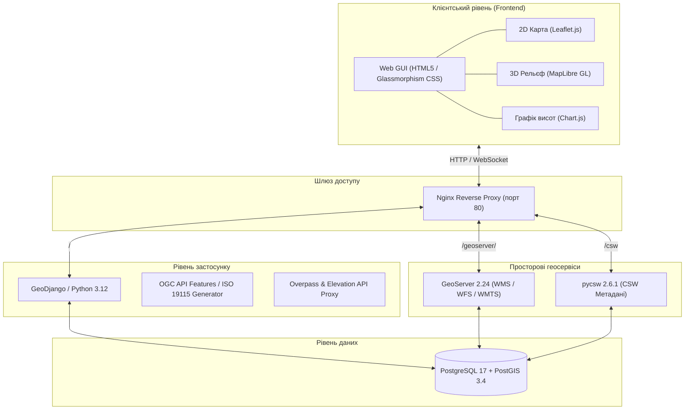

# 🌍 GeoPortalTurism — Туристичний геопортал Карпатського регіону

[](https://www.python.org/)
[](https://www.djangoproject.com/)
[](https://postgis.net/)
[](https://geoserver.org/)
[](https://opengeospatial.org/)
[](https://www.docker.com/)

**GeoPortalTurism** — це повнофункціональна геоінформаційна веб-система (Web-GIS) для дослідження туристичного потенціалу, пам'яток культурної спадщини, природних об'єктів та туристичних маршрутів Івано-Франківської області та Карпатського регіону.

Проєкт розроблено з дотриманням міжнародних стандартів **OGC (Open Geospatial Consortium)** та вимог **НІГД України** (Національної інфраструктури геопросторових даних).

---

## 🗺️ Ключові функціональні можливості

### 1. Дворежимне картографічне відображення (2D / 3D)
* **2D Інтерактивна карта (Leaflet.js):** кластеризація локацій (`Leaflet.markercluster`), теплова карта щільності об'єктів, векторні шари районів та територіальних громад. Перемикання базових картографічних підложок (OpenStreetMap, Супутник ESRI, Топографічна карта).
* **3D Візуалізація рельєфу (MapLibre GL):** повноцінне тривимірне середовище з генерацією цифрової моделі рельєфу (3D Terrain DEM), регулюванням кута нахилу камери (*pitch*), орієнтації (*bearing*) та збереженням просторового стану при переході між 2D і 3D.

### 2. Маршрутизація та просторовий аналіз рельєфу
* **Планування маршрутів:** інтерактивний вибір точок інтересу на карті та розрахунок оптимального автомобільного/пішохідного шляху за допомогою **Leaflet Routing Machine (OSRM)** з виведенням кілометражу і розрахункового часу.
* **Висотний профіль (Elevation Profile):** динамічна побудова рельєфного розрізу маршруту за допомогою **Chart.js** та API матриць висот **OpenTopoData (SRTM 90m)**. Реалізовано синхронізацію положення курсора на графіку з маркером-покажчиком на карті.
* **Експорт навігації:** пряма передача точок сформованого маршруту в мобільні навігатори **Google Maps** та **Waze**.

### 3. Сервіс пошуку житла та об'єктів інфраструктури
* **Location-based пошук житла:** формування параметризованих пошукових запитів до сервісів **Booking.com**, **Airbnb** та **Google Готелі** з прив'язкою до поточного географічного екстенту огляду карти (*bounding box / zoom*).
* **Динамічні POI (Overpass API):** інтеграція з базою OpenStreetMap через власний бекенд-проксі для миттєвого завантаження питних джерел, кемпінгів, закладів харчування, парковок та медичних пунктів.

### 4. Інтероперабельність та стандарти відкритих геоданих (OGC / НІГД)
* **OGC API Features (Part 1: Core):** RESTful endpoints (`/ogc/collections/{id}/items/`) з підтримкою фільтрації за `bbox`, лімітом і зміщенням у форматі GeoJSON.
* **ISO 19115:2003 / ISO 19139 XML:** автоматична генерація стандартизованих XML-паспортів метаданих набору геоданих.
* **GeoServer & PyCSW:** публікація шарів картографічних сервісів **WMS**, **WFS**, **WMTS** та каталогу метаданих **CSW 2.0.2**.
* **Панель швидкого підключення:** модуль експорту URL-адрес для прямого імпорту шарів у настільні ГІС (**QGIS**, **ArcGIS**).

### 5. Реєстр гідів та сервісна підтримка
* База сертифікованих туристичних гідів з фільтрацією за регіонами та інтерактивними кнопками прямого зв'язку (Telegram, WhatsApp, телефон, соціальні мережі).

---

## 🏛️ Архітектура системи



---

## 💻 Технологічний стек

* **Бекенд:** Python 3.12, Django 5.0, GeoDjango, Gunicorn, psycopg2.
* **База даних:** PostgreSQL 17, PostGIS 3.4 (просторові індекси GiST, просторові запити ST_Within, ST_Intersects, ST_AsGeoJSON).
* **ГІС-сервери:** GeoServer 2.24, pycsw 2.6.1.
* **Фронтенд:** Vanilla JavaScript (ES6+), Leaflet 1.9, MapLibre GL 4, Chart.js, Leaflet Routing Machine, OpenStreetMap.
* **Зовнішні геосервіси:** Overpass API (OSM POI), OpenTopoData (SRTM 90m DEM), Google Maps, Waze.
* **Інфраструктура:** Docker, Docker Compose, Nginx.

---

## 📁 Структура репозиторію

```text
.
├── accounts/               # Модуль автентифікації та управління користувачами
├── docker/                 # Конфігурації Docker (Dockerfile, Nginx, pycsw, GeoServer)
│   ├── Dockerfile          # Збірка Django оточення з GDAL/GEOS бібліотеками
│   ├── geoserver_setup.sh  # Скрипт автоматизації створення workspace/datastore у GeoServer
│   ├── nginx.conf          # Конфігурація зворотного проксі Nginx
│   └── pycsw.cfg           # Конфігурація каталогу метаданих CSW
├── geoportal/              # Головні налаштування проєкту Django (settings, urls, wsgi)
├── maps/                   # Основний ГІС-додаток геопорталу
│   ├── admin.py            # Налаштування розширеної адмін-панелі (GISModelAdmin)
│   ├── iso19115.py         # Модуль генерації XML метаданих ISO 19115 / ISO 19139
│   ├── models.py           # Просторові моделі (Location, Route, Region, Guide тощо)
│   ├── ogc_views.py        # Реалізація стандарту OGC API Features Part 1: Core
│   ├── urls.py             # Маршрутизація API та публічних сторінок
│   └── views.py            # Контролери візуалізації, проксі Overpass та висот
├── metadata/               # Паспорти метаданих шарів у форматі XML
├── static/css/             # Таблиці стилів (кастомна темна скляна тема сайдбару)
├── templates/              # HTML-шаблони (головна карта, адмінка, авторизація)
├── compose.yaml            # Головний оркестратор Docker Compose (всі 5 сервісів)
├── manage.py               # Точка входу управління Django
├── requirements.txt        # Залежності Python
└── .env.example            # Шаблон конфігурації змінних оточення
```

---

## 🚀 Швидкий старт (Розгортання у Docker)

### Вимоги:
* Встановлений **Docker** та **Docker Compose** (версія v2+).
* Вільні порти: `80` (HTTP веб-сайт), `5432` (БД PostGIS), `8080` (GeoServer), `8001` (pycsw).

### Крок 1. Клонування репозиторію
```bash
git clone https://github.com/giswebtest/GeoPortalTurism.git
cd GeoPortalTurism
```

### Крок 2. Налаштування змінних оточення
Створіть файл `.env` на основі наданого зразка:
```bash
cp .env.example .env
```

### Крок 3. Запуск контейнерів
Запустіть повний стек сервісів:
```bash
docker compose up -d --build
```
> *Під час першого запуску автоматично створяться таблиці БД, застосуються міграції Django та збереться статика.*

### Крок 4. Створення облікового запису адміністратора
```bash
docker compose exec web python manage.py createsuperuser
```

---

## 🌐 Доступні сервіси після запуску

| Сервіс | URL-адреса | Опис |
|---|---|---|
| **Головна карта геопорталу** | [http://localhost](http://localhost) | Інтерактивна 2D/3D карта з фільтрами та навігацією |
| **Панель адміністратора** | [http://localhost/admin/](http://localhost/admin/) | Керування локаціями, маршрутами, категоріями та гідами |
| **OGC API Features** | [http://localhost/ogc/](http://localhost/ogc/) | Відкритий RESTful GeoJSON API стандарт |
| **GeoServer** | [http://localhost:8080/geoserver](http://localhost:8080/geoserver) | WMS, WFS та WMTS картографічні сервіси (`admin`/`geoserver`) |
| **pycsw (Каталог метаданих)** | [http://localhost:8001/csw](http://localhost:8001/csw) | Каталог геопросторових метаданих за стандартом CSW 2.0.2 |

---

## 🔗 Підключення до настільних ГІС (QGIS / ArcGIS)

Геопортал підтримує пряму трансляцію даних у десктопні ГІС-пакети. Скопіюйте посилання у меню **«🔗 Підключити дані»** на сайті або використайте прямі адреси:
* **WMS (Растрові шари):** `http://localhost/geoserver/geoportal/wms?SERVICE=WMS&REQUEST=GetCapabilities`
* **WFS (Векторні об'єкти):** `http://localhost/geoserver/ows?service=WFS&request=GetCapabilities`
* **OGC API Features:** `http://localhost/ogc/collections/locations/items/`

---

## 👤 Автор
* **Максим Гаршин** ([@giswebtest](https://github.com/giswebtest)) — розробка геопорталу, проектування просторових баз даних, налаштування картографічних сервісів.
* Проєкт розроблено в межах кваліфікаційної магістерської роботи.
