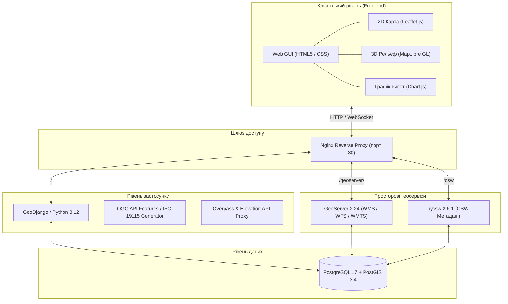

# GeoPortalTurism — Туристичний геопортал

[](https://www.python.org/)
[](https://www.djangoproject.com/)
[](https://postgis.net/)
[](https://geoserver.org/)
[](https://opengeospatial.org/)
[](https://www.docker.com/)


---

## Ключові функціональні можливості

### 1. Дворежимне картографічне відображення (2D / 3D)
### 2. Маршрутизація та просторовий аналіз рельєфу
### 3. Сервіс пошуку житла та об'єктів інфраструктури
### 4. Інтероперабельність та стандарти відкритих геопросторових даних 
### 5. Реєстр гідів та сервісна підтримка


##  Архітектура системи



---

## Технологічний стек

* **Бекенд:** Python 3.12, Django 5.0, GeoDjango, Gunicorn, psycopg2.
* **База даних:** PostgreSQL 17, PostGIS 3.4 (просторові індекси GiST, просторові запити ST_Within, ST_Intersects, ST_AsGeoJSON).
* **ГІС-сервери:** GeoServer 2.24, pycsw 2.6.1.
* **Фронтенд:** Vanilla JavaScript (ES6+), Leaflet 1.9, MapLibre GL 4, Chart.js, Leaflet Routing Machine, OpenStreetMap.
* **Зовнішні геосервіси:** Overpass API (OSM POI), OpenTopoData (SRTM 90m DEM), Google Maps, Waze.
* **Інфраструктура:** Docker, Docker Compose, Nginx.

---

## Структура репозиторію

```text
.
├── accounts/               # Модуль автентифікації та управління користувачами
├── docker/                 # Конфігурації Docker (Dockerfile, Nginx, pycsw, GeoServer)
│   ├── Dockerfile          # Збірка Django оточення з GDAL/GEOS бібліотеками
│   ├── geoserver_setup.sh  # Скрипт автоматизації створення workspace/datastore у GeoServer
│   ├── nginx.conf          # Конфігурація зворотного проксі Nginx
│   └── pycsw.cfg           # Конфігурація каталогу метаданих CSW
├── geoportal/              # Головні налаштування проєкту Django (settings, urls, wsgi)
├── maps/                   # Основний ГІС-додаток геопорталу
│   ├── admin.py            # Налаштування розширеної адмін-панелі (GISModelAdmin)
│   ├── iso19115.py         # Модуль генерації XML метаданих ISO 19115 / ISO 19139
│   ├── models.py           # Просторові моделі (Location, Route, Region, Guide тощо)
│   ├── ogc_views.py        # Реалізація стандарту OGC API Features Part 1: Core
│   ├── urls.py             # Маршрутизація API та публічних сторінок
│   └── views.py            # Контролери візуалізації, проксі Overpass та висот
├── metadata/               # Паспорти метаданих шарів у форматі XML
├── static/css/             # Таблиці стилів (кастомна темна скляна тема сайдбару)
├── templates/              # HTML-шаблони (головна карта, адмінка, авторизація)
├── compose.yaml            # Головний оркестратор Docker Compose (всі 5 сервісів)
├── manage.py               # Точка входу управління Django
├── requirements.txt        # Залежності Python
└── .env.example            # Шаблон конфігурації змінних оточення
```

---

## Швидкий старт (Розгортання у Docker)

### Вимоги:
* Встановлений **Docker** та **Docker Compose** (версія v2+).
* Вільні порти: `80` (HTTP веб-сайт), `5432` (БД PostGIS), `8080` (GeoServer), `8001` (pycsw).

### Крок 1. Клонування репозиторію
```bash
git clone https://github.com/giswebtest/GeoPortalTurism.git
cd GeoPortalTurism
```

### Крок 2. Налаштування змінних оточення
Створіть файл `.env` на основі наданого зразка:
```bash
cp .env.example .env
```

### Крок 3. Запуск контейнерів
Запустіть повний стек сервісів:
```bash
docker compose up -d --build
```
> *Під час першого запуску автоматично створяться таблиці БД, застосуються міграції Django та збереться статика.*

### Крок 4. Створення облікового запису адміністратора
```bash
docker compose exec web python manage.py createsuperuser
```

---

##  Доступні сервіси після запуску

| Сервіс | URL-адреса | Опис |
|---|---|---|
| **Головна карта геопорталу** | [http://localhost](http://localhost) | Інтерактивна 2D/3D карта з фільтрами та навігацією |
| **Панель адміністратора** | [http://localhost/admin/](http://localhost/admin/) | Керування локаціями, маршрутами, категоріями та гідами |
| **OGC API Features** | [http://localhost/ogc/](http://localhost/ogc/) | Відкритий RESTful GeoJSON API стандарт |
| **GeoServer** | [http://localhost:8080/geoserver](http://localhost:8080/geoserver) | WMS, WFS та WMTS картографічні сервіси (`admin`/`geoserver`) |
| **pycsw (Каталог метаданих)** | [http://localhost:8001/csw](http://localhost:8001/csw) | Каталог геопросторових метаданих за стандартом CSW 2.0.2 |

---

##  Підключення до настільних ГІС 

Геопортал підтримує пряму обмін даних у десктопні ГІС-пакети. Скопіюйте посилання у меню **«🔗 Підключити дані»** на сайті або використайте прямі адреси:
* **WMS (Растрові шари):** `http://localhost/geoserver/geoportal/wms?SERVICE=WMS&REQUEST=GetCapabilities`
* **WFS (Векторні об'єкти):** `http://localhost/geoserver/ows?service=WFS&request=GetCapabilities`
* **OGC API Features:** `http://localhost/ogc/collections/locations/items/`

---

##  Автор
* **Максим Гаршин Валерійович** ([@giswebtest](https://github.com/giswebtest)) — розробник геопорталу.
* Проєкт розроблено в межах кваліфікаційної магістерської роботи.
